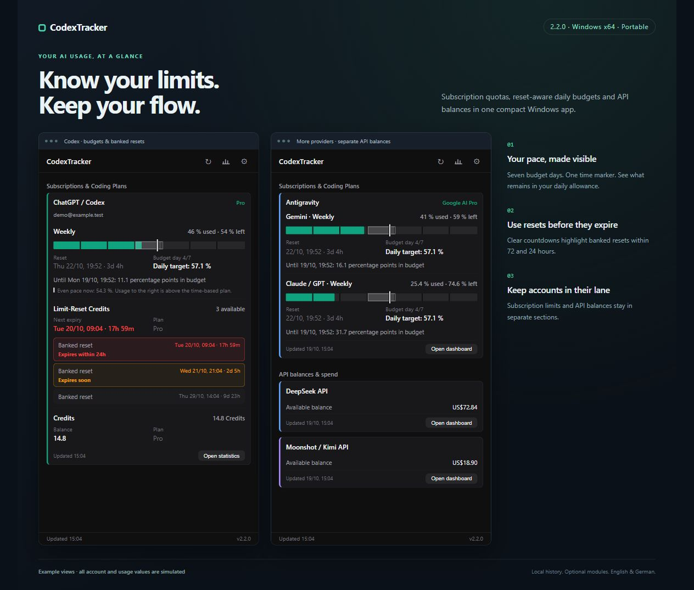
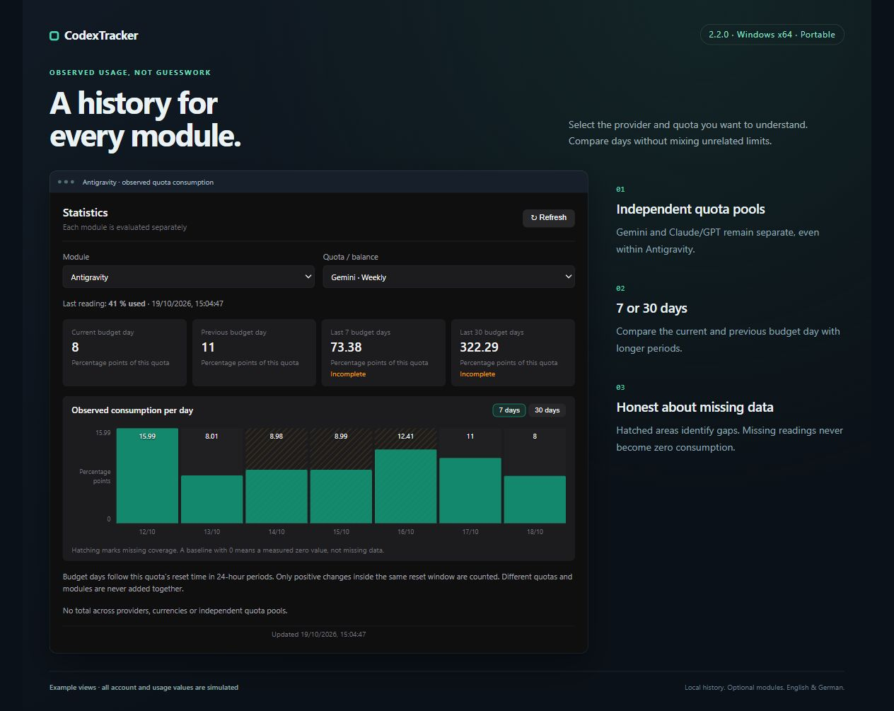
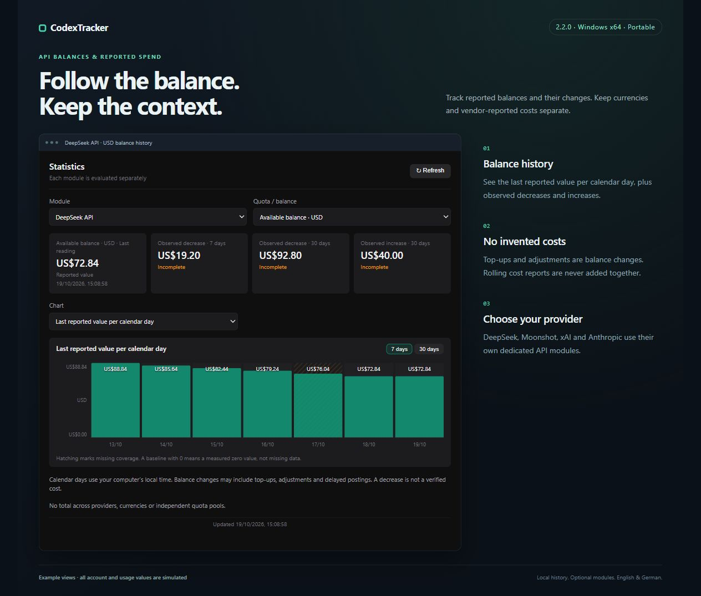
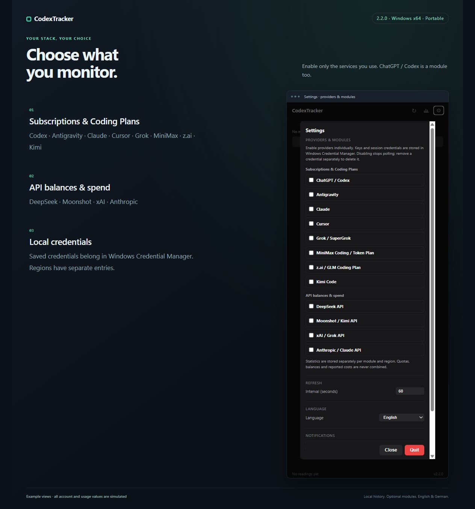

# CodexTracker

**Your AI usage, in one small window.**

Monitor subscription quotas, plan your daily allowance, and follow API balances with a portable Windows app. Choose the modules you use: ChatGPT / Codex, Antigravity, Claude, Cursor, Grok, MiniMax, z.ai, Kimi and more.

<p>
  
  
  
  <a href="LICENSE"></a>
</p>

[**Download for Windows**](https://github.com/mariojacob/codextracker/releases/latest) · [Provider setup](docs/providers.md) · [What's new in 2.2.0](docs/releases/v2.2.0.md)



*Screenshots show the actual 2.2.0 interface with simulated account and usage data. The two dashboard panels illustrate separate example configurations. Available data depends on the provider and account.*

## Features

| Plan your usage | Understand your history | Choose your stack |
| --- | --- | --- |
| Used **and** remaining quota, reset times, seven budget-day segments and an even-pace marker. | Current/previous day and 7-/30-day views, with observed consumption and visible data gaps. | Enable or disable each module in Settings, including ChatGPT / Codex. |
| Banked resets sorted by expiry, with clear 72-hour and 24-hour highlights. | Separate provider, region, model quota and currency selectors. | Subscription quotas and API balances/spend stay in separate groups. |
| Unused daily allowance carries forward within the weekly window. | Balance decreases, increases and vendor-reported cost trends retain their meaning. | English/German UI, local history and Windows Credential Manager storage. |

CodexTracker does not estimate token counts or API costs. It displays balances and expenses only when the provider reports them.

## Providers & modules

| Subscriptions & Coding Plans | API balances & spend |
| --- | --- |
| ChatGPT / Codex, Antigravity, Claude, Cursor, Grok / SuperGrok, MiniMax Coding / Token Plan, z.ai / GLM, Kimi Code | DeepSeek, Moonshot / Kimi API, xAI / Grok API, Anthropic / Claude API |

Open **Settings → Providers & modules** to configure each service. Additional providers are off by default; Codex remains enabled for compatibility. Disabling a module stops its polling while preserving its saved login and history. Some integrations require a specific plan key, session cookie, OAuth login, management key or organization Admin key. See the [setup guide and compatibility notes](docs/providers.md).

> **Community project:** Not affiliated with or endorsed by the supported providers. Several integrations, including Codex's ChatGPT `/backend-api/wham/*` endpoints, use private interfaces that may change or become unavailable.

## Statistics that keep the context

Select a module and an individual quota to compare observed consumption. Weekly budget days follow the reset time; other quota windows and API trends use local calendar days. Missing measurements are shown as gaps rather than zero consumption. New modules start collecting their own history when enabled.



<details>
<summary><strong>More screenshots: API balances and module settings</strong></summary>

### API balances & reported spend

Balances, observed changes and reported costs remain separate. A balance decrease is not treated as a verified expense, and rolling cost reports are never added together.



### Enable only what you use

Each provider has its own switch and setup instructions. Credentials stay in Windows Credential Manager; regional accounts use separate entries.



</details>

## Requirements

- Windows 10 or Windows 11, x64
- For the Codex module: Codex CLI installed and signed in with OAuth
- For other modules: the provider-specific app or credentials described in the [setup guide](docs/providers.md)

## Portable installation

1. Download the latest `CodexTracker-<version>.exe` and matching `.exe.sha256` file from the project's GitHub Releases page.
2. Place the executable in any folder and run it. No installation is performed.
3. Open Settings and choose the modules you want to monitor. For Codex, import your existing CLI sign-in; other modules can run independently.

The executable is currently unsigned because the project does not have a trusted code-signing certificate. Windows SmartScreen may therefore display an “unrecognized app” warning. Verify the checksum before running the file and download release assets only from the project's GitHub Releases page. A self-signed certificate is intentionally not used because it would not establish public trust or meaningfully improve SmartScreen reputation.

### Verify SHA-256

Run PowerShell in the download folder:

```powershell
$exe = Get-ChildItem .\CodexTracker-*.exe | Select-Object -First 1
$expected = (Get-Content "$($exe.FullName).sha256").Split(' ')[0].Trim()
$actual = (Get-FileHash $exe.FullName -Algorithm SHA256).Hash.ToLowerInvariant()
if ($actual -ne $expected.ToLowerInvariant()) { throw 'Checksum mismatch' }
'Checksum verified'
```

## Privacy and local data

CodexTracker reads `%USERPROFILE%\.codex\auth.json` only when you explicitly select **Import from Codex CLI**. The imported refresh token is stored as service `CodexTracker`, account `codex-oauth-refresh-token`, in Windows Credential Manager. Access tokens and their expiration time exist only in application memory. The OpenID `id_token` is neither needed nor stored.

Non-secret account metadata is stored in `%USERPROFILE%\.codex-tracker\config.json`. Settings and local history are stored in `settings.json` and `history.jsonl` in the same directory. History contains quota percentages (or null for missing windows), reset times, window durations, the polling interval, credit balances, reset-credit counts, a data version, and timestamps; it does not contain OAuth tokens.

The application connects to:

- `auth.openai.com` to refresh the OAuth access token;
- `chatgpt.com` to request Codex quota and reset-credit data through private, unofficial endpoints.

When you enable additional providers, it also connects to their documented [provider-specific hosts](docs/providers.md#network-sources-and-compatibility). Additional credentials are stored separately by provider and region in Windows Credential Manager. Numeric usage history is stored locally under `.codex-tracker/provider-history`, excluding credentials and raw responses. Statistics cover the most recent 30 days and select each module, region and quota/currency separately; see [history semantics](docs/providers.md#credentials-and-refresh). Signing out of Codex does not sign out of other providers. Disable them and remove their credentials in Settings separately.

Budget days are seven equal 24-hour periods anchored to the weekly reset instant, rather than midnight. The current day's allowance includes unused allowance from earlier days of the same week. The time marker shows an even consumption pace; it is a planning aid, not an additional service limit. Around daylight-saving changes, the displayed local hour can shift because the periods are elapsed 24-hour intervals.

Statistics sum observed decreases in remaining weekly quota within the same reset window, expressed as percentage points. Resets, absent measurements, and gaps longer than the larger of five minutes or twice the polling interval are not interpreted as consumption. Short intervals crossing a budget-day boundary are split proportionally and marked approximate. Hatched chart areas and incomplete totals show missing coverage. Older history remains on disk but is not used to reconstruct daily consumption because it lacks reliable reset information. Credit decreases and increases are observed balance changes, not billing estimates. Totals over multiple reset windows may exceed 100 percentage points.

Available banked resets are sorted by expiry, highlighted yellow within 72 hours and red within 24 hours. Unknown expiry dates are labeled explicitly. Highlighting does not redeem a reset or create an extra notification.

Signing out removes the Credential Manager entry and non-secret authentication metadata. It intentionally keeps settings and history. To remove all local application data, close CodexTracker, delete `%USERPROFILE%\.codex-tracker`, and remove the `CodexTracker` / `codex-oauth-refresh-token` entry from Windows Credential Manager if it still exists.

Credentials belong to the current Windows user. Moving the portable executable to another computer or Windows account requires importing the Codex CLI sign-in again.

## Development

Node.js 22.12 or newer and npm are required.

```powershell
npm ci
npm run type-check
npm test
npm run build
npm run package:portable
```

`npm run package:portable` produces only these files in `release/`:

- `CodexTracker-<version>.exe`
- `CodexTracker-<version>.exe.sha256`

The project supports only Windows x64 packaging. The native Windows Credential Manager module must be present in the packaged `app.asar.unpacked` directory during build verification.

### Reproduce the README screenshots

After `npm run build`, run `node scripts/screenshots/preview.cjs` and open `http://127.0.0.1:5181/showcase/dashboard`. Other scenes are `/showcase/statistics`, `/showcase/api` and `/showcase/settings`. For the settings scene, open the gear menu before capturing. The preview binds to loopback and supplies in-memory fake data to the compiled UI; it does not read real credentials and is excluded from the portable executable.

## Publishing releases

The `release/` directory is intentionally ignored by Git. Commit only source code. Create a GitHub release for the version declared in `package.json`, then upload the portable executable and its SHA-256 file as separate release assets. Do not commit unpacked application folders, builder diagnostics, installers, or executable binaries.

## Security

Please read [SECURITY.md](SECURITY.md) before reporting a vulnerability. Never attach Codex CLI auth files, CodexTracker configuration files, access tokens, refresh tokens, or raw debug responses to a public issue.

## License

MIT License. See [LICENSE](LICENSE).
