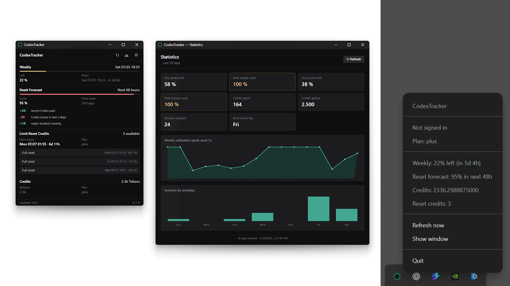

# CodexTracker

CodexTracker is a small, portable Windows application that displays Codex quota windows, reset credits, account credits, reset forecasts, and local usage statistics.

> **Unofficial project:** CodexTracker is not affiliated with, endorsed by, or supported by OpenAI. It relies on private, undocumented ChatGPT `/backend-api/wham/*` endpoints that may change or stop working without notice.

<p align="center">
  
</p>

## Features

- Session and weekly quota status with reset times
- Available limit-reset credits
- Credit balance
- Optional reset forecast from `willcodexquotareset.com`
- Local 30-day quota, credit, and session statistics
- English and German interface
- Windows Credential Manager integration for the OAuth refresh token
- Portable Windows x64 executable; no installer required

CodexTracker deliberately does not estimate API costs or token counts.

## Requirements

- Windows 10 or Windows 11, x64
- Codex CLI installed and signed in with OAuth

## Portable installation

1. Download the latest `CodexTracker-<version>.exe` and matching `.exe.sha256` file from the project's GitHub Releases page.
2. Place the executable in any folder and run it. No installation is performed.
3. When prompted, import the existing Codex CLI sign-in.

The executable is currently unsigned because the project does not have a trusted code-signing certificate. Windows SmartScreen may therefore display an “unrecognized app” warning. Verify the checksum before running the file and download release assets only from the project's GitHub Releases page. A self-signed certificate is intentionally not used because it would not establish public trust or meaningfully improve SmartScreen reputation.

### Verify SHA-256

Run PowerShell in the download folder:

```powershell
$exe = Get-ChildItem .\CodexTracker-*.exe | Select-Object -First 1
$expected = (Get-Content "$($exe.FullName).sha256").Split(' ')[0].Trim()
$actual = (Get-FileHash $exe.FullName -Algorithm SHA256).Hash.ToLowerInvariant()
if ($actual -ne $expected.ToLowerInvariant()) { throw 'Checksum mismatch' }
'Checksum verified'
```

## Privacy and local data

CodexTracker reads `%USERPROFILE%\.codex\auth.json` only when you explicitly select **Import from Codex CLI**. The imported refresh token is stored as service `CodexTracker`, account `codex-oauth-refresh-token`, in Windows Credential Manager. Access tokens and their expiration time exist only in application memory. The OpenID `id_token` is neither needed nor stored.

Non-secret account metadata is stored in `%USERPROFILE%\.codex-tracker\config.json`. Settings and local history are stored in `settings.json` and `history.jsonl` in the same directory. History contains quota percentages, credit balances, reset-credit counts, and timestamps; it does not contain OAuth tokens.

The application connects to:

- `auth.openai.com` to refresh the OAuth access token;
- `chatgpt.com` to request Codex quota and reset-credit data through private, unofficial endpoints; and
- `willcodexquotareset.com` to retrieve the optional public reset forecast.

No OpenAI token, account identifier, email address, credit balance, quota value, history entry, or other personal usage value is sent to `willcodexquotareset.com`. Like any web service, it can still receive ordinary network metadata such as your IP address and standard HTTP request information.

Signing out removes the Credential Manager entry and non-secret authentication metadata. It intentionally keeps settings and history. To remove all local application data, close CodexTracker, delete `%USERPROFILE%\.codex-tracker`, and remove the `CodexTracker` / `codex-oauth-refresh-token` entry from Windows Credential Manager if it still exists.

Credentials belong to the current Windows user. Moving the portable executable to another computer or Windows account requires importing the Codex CLI sign-in again.

## Development

Node.js 22.12 or newer and npm are required.

```powershell
npm ci
npm run type-check
npm test
npm run build
npm run package:portable
```

`npm run package:portable` produces only these files in `release/`:

- `CodexTracker-<version>.exe`
- `CodexTracker-<version>.exe.sha256`

The project supports only Windows x64 packaging. The native Windows Credential Manager module must be present in the packaged `app.asar.unpacked` directory during build verification.

## Publishing releases

The `release/` directory is intentionally ignored by Git. Commit only source code. Create a GitHub release for the version declared in `package.json`, then upload the portable executable and its SHA-256 file as separate release assets. Do not commit unpacked application folders, builder diagnostics, installers, or executable binaries.

## Security

Please read [SECURITY.md](SECURITY.md) before reporting a vulnerability. Never attach Codex CLI auth files, CodexTracker configuration files, access tokens, refresh tokens, or raw debug responses to a public issue.

## License

MIT License. See [LICENSE](LICENSE).
